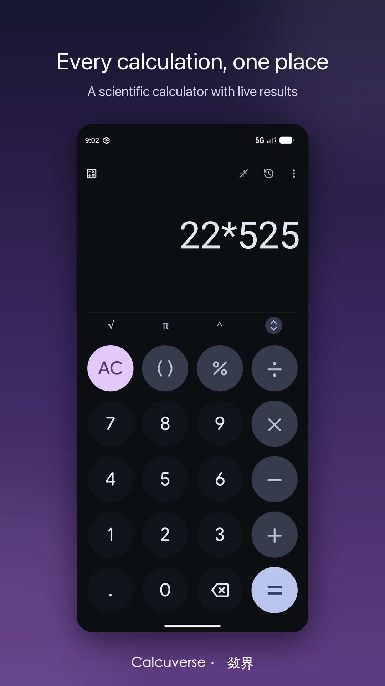
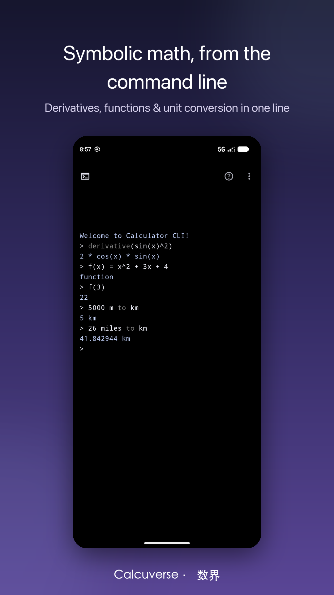
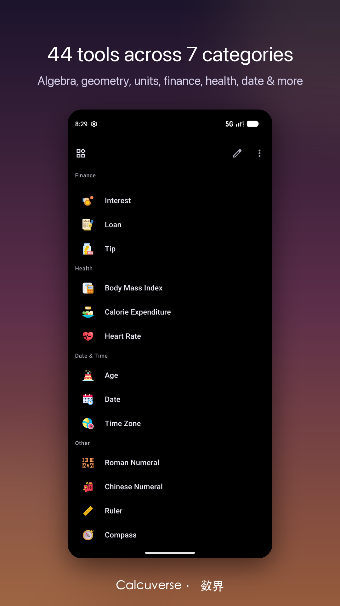
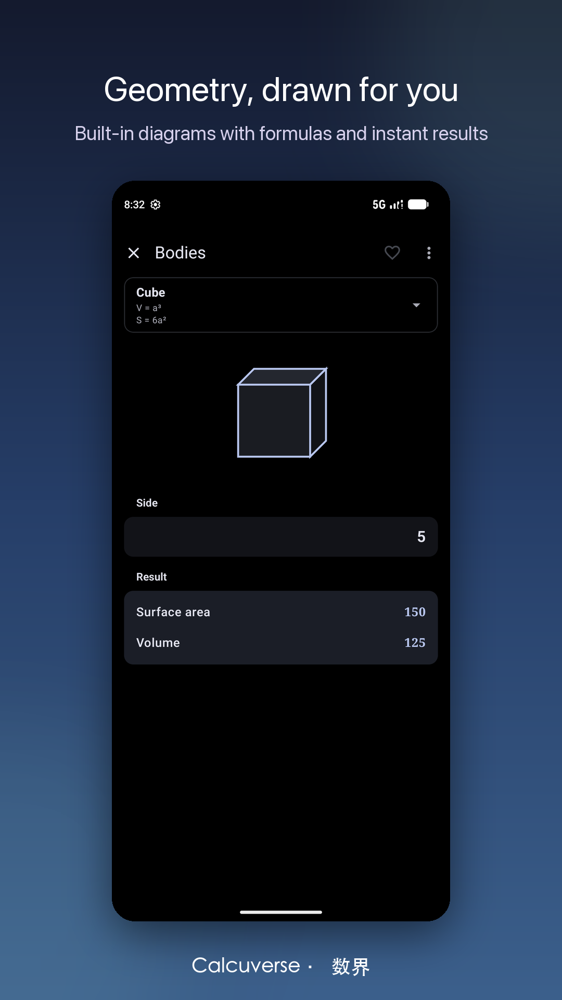
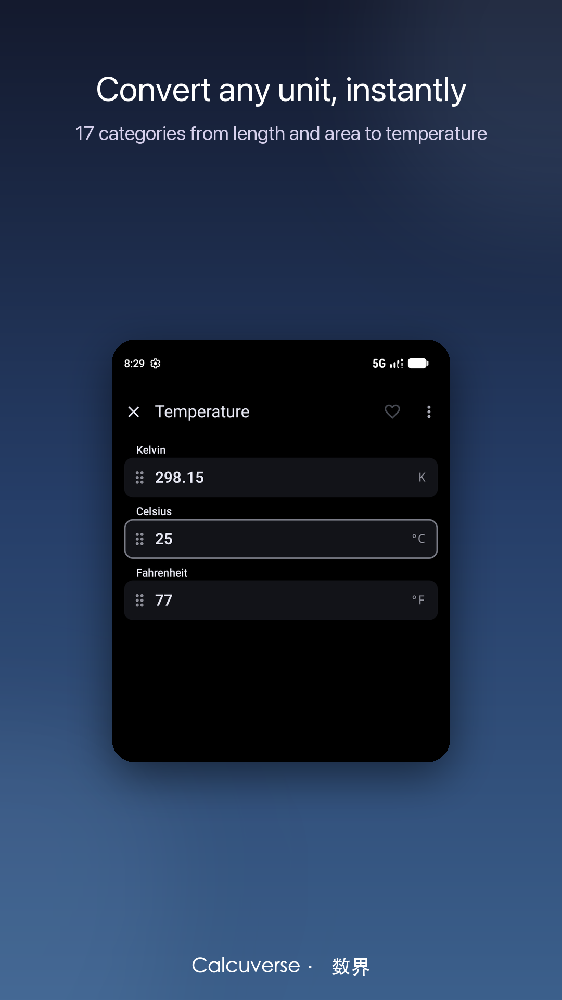
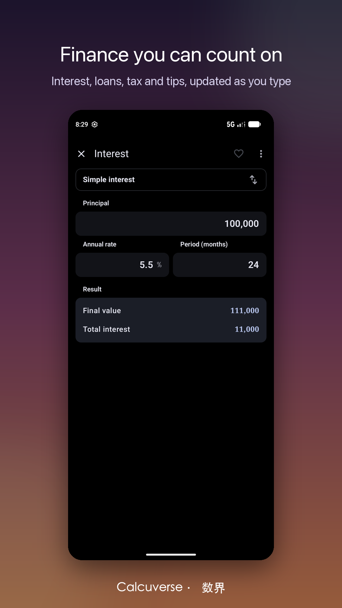
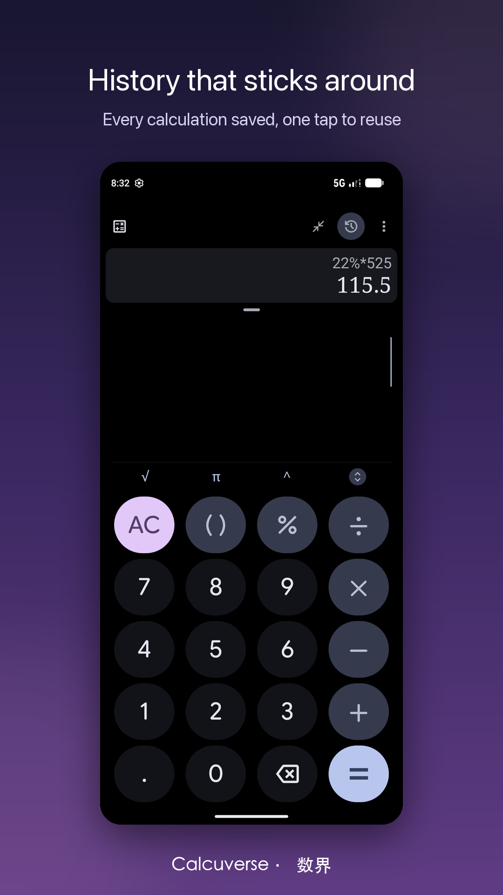
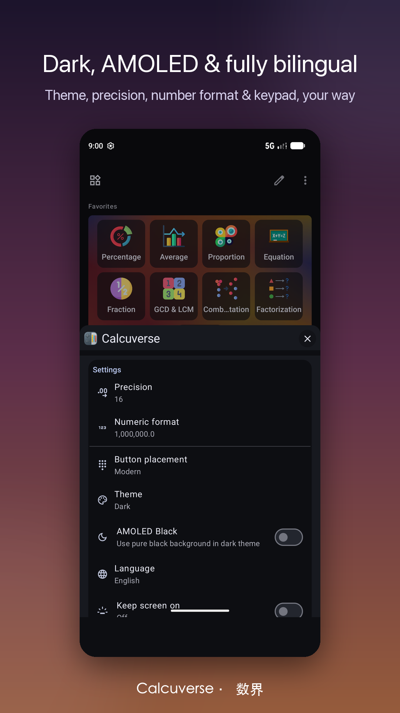

# Calcuverse · 数界

**Every calculation, one place — the all-in-one calculator toolkit.**

Calcuverse is a universal calculator and utility suite built with **Kotlin Multiplatform + Compose Multiplatform**, running natively on **Android, iOS, and Desktop (JVM)**. It brings your everyday calculator, unit converters, finance and health tools into one clean, distraction-free app — complete with a **floating overlay calculator** and **home-screen widget** so answers are always one tap away.

---

## ✨ Highlights

- **🧮 Full scientific calculator** — trig functions, logarithms, roots, factorials, percentages and more, with live results and saved history.
- **🪟 Floating calculator** — a draggable, resizable, translucent overlay that works on top of any app, so you can calculate without switching away (Android).
- **📱 Home-screen widget** — run quick calculations right from your home screen.
- **🔢 44 tools across 7 categories** — math, geometry, unit conversion, finance, health, date & time, and everyday utilities in a single app.
- **💱 Offline currency conversion** — built-in European Central Bank reference rates, refreshed daily and available offline.
- **🎨 Adaptive & personal** — a modern Material 3 / Material You interface with light & dark themes and multiple color schemes.
- **📴 Privacy-friendly** — all calculations and history stay on your device. Nothing is uploaded to our servers.

---

## 🧰 All 44 tools

| Category | Tools |
| --- | --- |
| **Algebra** | Percentage, Average, Proportion, Equation solver, Fractions, GCD / LCM, Combinations & Permutations, Factorization, Random number generator |
| **Geometry** | 2D shapes, 3D solids |
| **Unit Converter** | Angle, Length, Area, Volume, Time, Mass, Temperature, Energy, Force, Power, Pressure, Speed, Acceleration, Storage, Torque, Fuel economy, Number base |
| **Finance** | Currency exchange, Unit price, Tax, Interest, Loan, Tip |
| **Health** | BMI, Calorie expenditure, Heart rate |
| **Date & Time** | Age, Date calculator, Time zone |
| **Other** | Roman numerals, Chinese numerals, Ruler, Compass |

---

## 📸 Screenshots

---

## 📥 Download

- **Android**: Google Play
- **iOS**: App Store
- **Desktop (Windows / macOS / Linux)**: coming soon

> Free to use with all core features. Upgrade to Premium to remove ads and unlock all premium features.

---

## 🛠️ About this project & open source

This repository is the official home and issue tracker for the **Calcuverse** app.

- The app **as a whole is not open source**. Its complete source code is proprietary and all rights are reserved by the developer.
- The developer **open-sources a selection of UI components** in a **separate** repository under the **Apache-2.0** license. That repository contains reusable UI components only — not the app's core business code.

If you'd like to reuse some of the UI components, please check the license and usage notes in the corresponding components repository.

---

## 📄 Privacy Policy & Terms of Service

- [Privacy Policy](./legal/privacy-policy.en.md) · [中文](./legal/privacy-policy.zh-CN.md)
- [Terms of Service](./legal/terms-of-service.en.md) · [中文](./legal/terms-of-service.zh-CN.md)

---

## 🧩 Tech stack

- **Kotlin Multiplatform** — one codebase, every platform
- **Compose Multiplatform** — shared declarative UI
- **Room** — local calculation history
- **DataStore** — preference persistence
- **Koin** — dependency injection
- **Ktor** — exchange-rate fetching
- **Firebase** — crash reporting, performance monitoring & analytics (Android)

---

## 🐞 Feedback & support

- Found a bug or have a feature request? Open an [issue](../../issues).
- Please include the **app version, device model, OS version**, and steps to reproduce.

---

## 📄 License

This application is proprietary. Copyright © 2026 Yang's Codehub. All rights reserved.
The separate open-source UI components repository is licensed under **Apache-2.0**.
