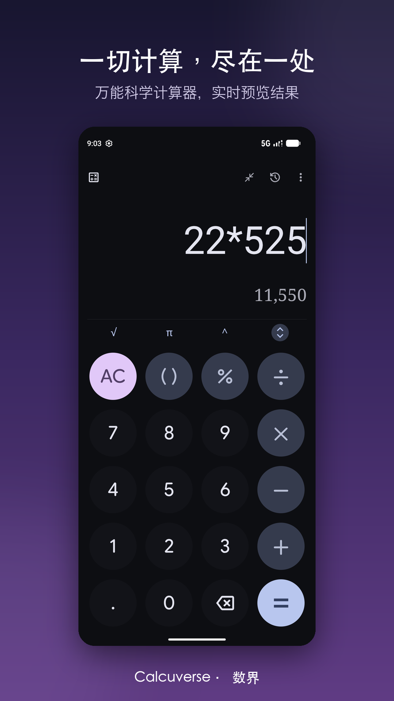
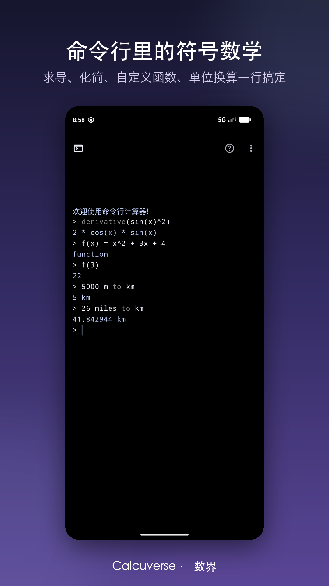
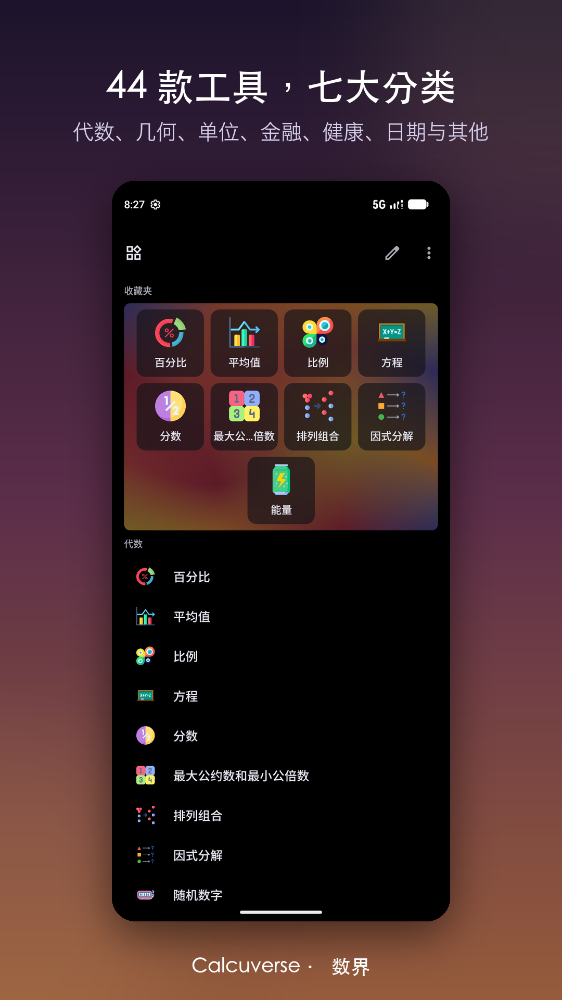
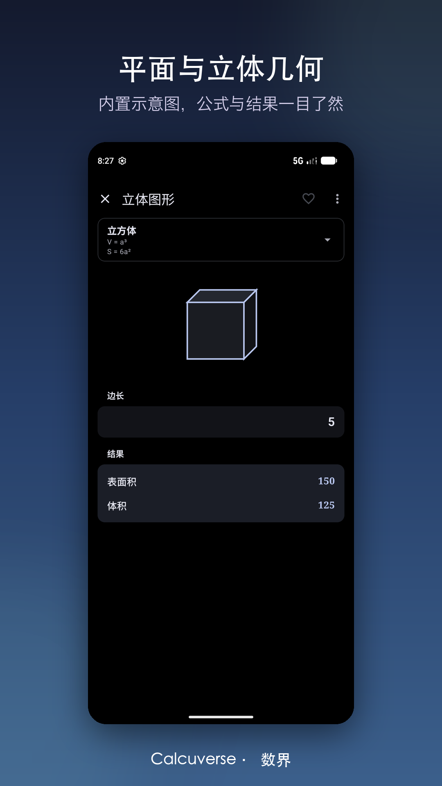
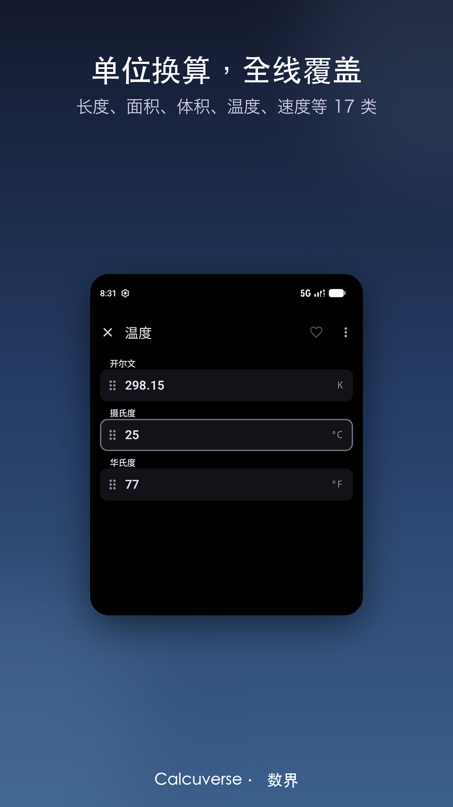
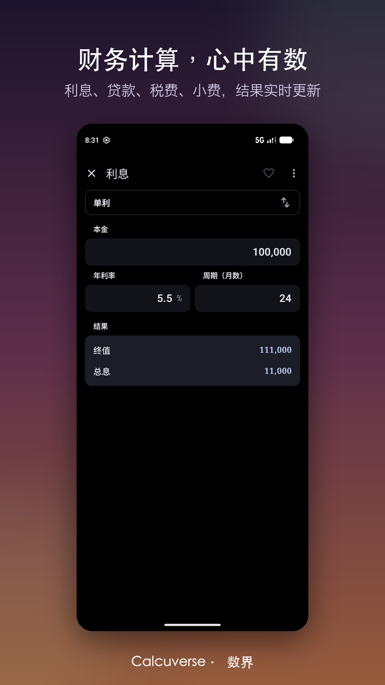
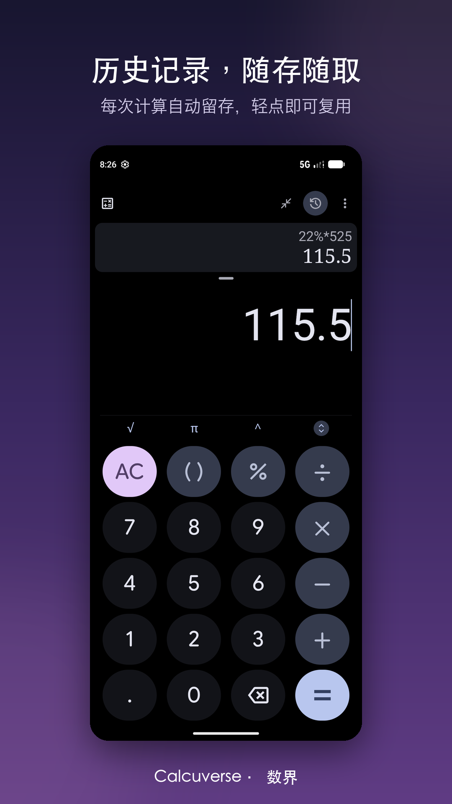
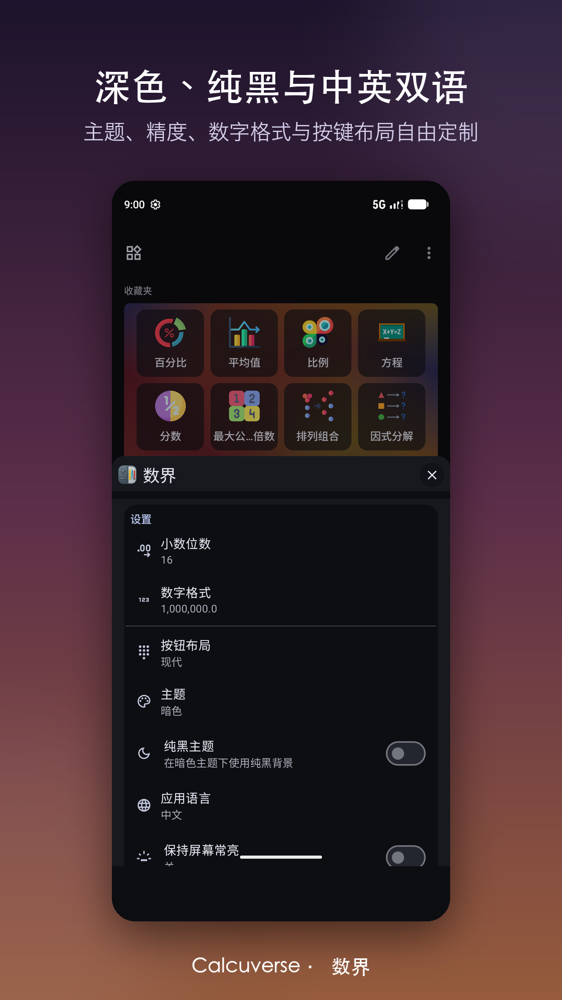

# Calcuverse · 数界

**万物皆可算 · 一应俱全的计算器工具**

数界（Calcuverse）是一款以 **Kotlin Multiplatform + Compose Multiplatform** 打造的全能计算器与实用工具应用，覆盖 Android、iOS 和桌面（JVM）三大平台。它把日常最常用的计算器、单位换算、财务与健康工具收进一个清爽、无广告干扰（付费版）的应用里，并配有**悬浮计算器**和**桌面小组件**，随手即可算。

---

## ✨ 核心亮点

- **🧮 全能科学计算器** —— 支持三角函数、对数、开方、阶乘、百分比等，实时显示结果并保存计算历史。
- **🪟 悬浮计算器** —— 可拖动、可调整大小与透明度的悬浮窗口，任意应用之上随算随走（Android）。
- **📱 桌面小组件** —— 无需打开应用，在桌面直接完成快速计算。
- **🔢 44 款实用工具 · 7 大分类** —— 从数学、几何到单位换算、财务、健康、日期时间和生活小工具，一站集成。
- **💱 汇率换算** —— 内置欧洲中央银行参考汇率并按日更新，离线亦可查用。
- **🎨 自适应与个性化** —— 基于 Material 3 与 Material You 的现代界面，支持深/浅色主题及多种配色。
- **📴 隐私友好** —— 所有计算内容与历史记录仅保存在本机，不上传服务器。

---

## 🧰 工具一览（44 款）

| 分类 | 工具 |
| --- | --- |
| **代数** | 百分比、平均值、比例、方程求解、分数、最大公约数/最小公倍数、排列组合、因数分解、随机数生成 |
| **几何** | 平面图形、立体图形 |
| **单位换算** | 角度、长度、面积、体积、时间、质量、温度、能量、力、功率、压强、速度、加速度、存储、力矩、油耗、进制转换 |
| **财务** | 汇率换算、单价、税费、利息、贷款、小费 |
| **健康** | BMI、卡路里消耗、心率 |
| **日期与时间** | 年龄、日期计算、时区 |
| **其他** | 罗马数字、中文数字、尺子、指南针 |

---

## 📸 截图

---

## 📥 下载

- **Android**：[Google Play](https://play.google.com/store/apps/details?id=com.yangdai.calcpro)
- **iOS**：App Store
- **桌面（Windows / macOS / Linux）**：即将发布

> 免费使用即可体验全部基础功能；升级高级版可移除广告并解锁全部高级特性。

---

## 🛠️ 关于本项目与开源说明

本仓库为 **数界（Calcuverse）** 应用的官方项目主页与问题追踪仓库。

- 应用**整体并非开源项目**，其完整源代码为开发者保留所有权利（Proprietary）。
- 开发者会**单独开源部分 UI 组件**，托管在独立的开源仓库中，并以 **Apache-2.0** 许可证发布。该开源仓库仅包含可复用的 UI 组件，不包含应用的核心业务代码。

如你希望复用部分 UI 组件，请前往相应的开源组件仓库查看许可证与使用说明。

---

## 📄 隐私权政策与使用条款

- [隐私权政策 (Privacy Policy)](./legal/privacy-policy.zh-CN.md) · [English](./legal/privacy-policy.en.md)
- [服务条款 (Terms of Service)](./legal/terms-of-service.zh-CN.md) · [English](./legal/terms-of-service.en.md)

---

## 🧩 技术栈

- **Kotlin Multiplatform** —— 一套逻辑，多端复用
- **Compose Multiplatform** —— 统一声明式 UI
- **Room** —— 本地计算历史存储
- **DataStore** —— 偏好设置持久化
- **Koin** —— 依赖注入
- **Ktor** —— 汇率数据获取
- **Firebase** —— 崩溃报告、性能监控与分析（Android）

---

## 🐞 反馈与支持

- 发现 Bug 或有功能建议？请提交 [Issue](../../issues)。
- 反馈时请附上**应用版本、设备型号、系统版本**及复现步骤，便于快速定位。

---

## 📄 许可

本应用为专有软件，版权所有 © 2026 Yang's Codehub，保留所有权利。
独立的 UI 组件开源仓库遵循 **Apache-2.0** 许可证。
